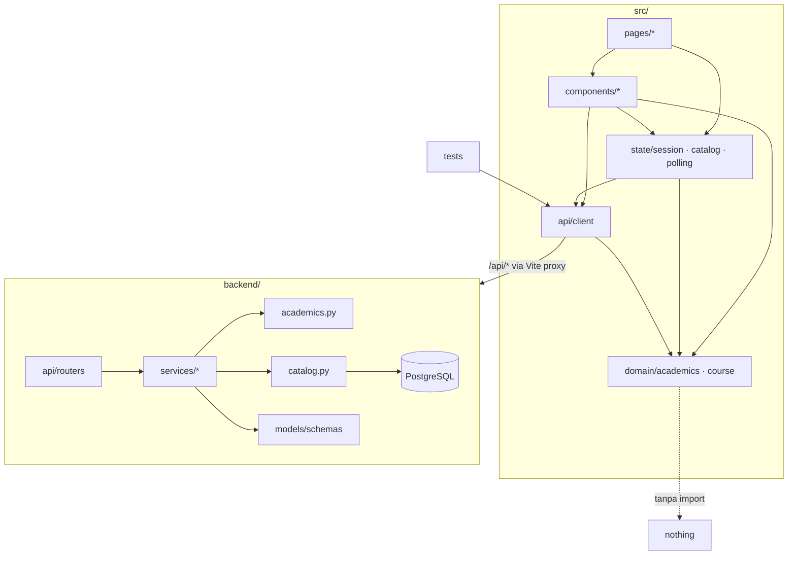

# Low-Level Refactor Plan: Untangle FTMM Compass

**Document ID:** `PLAN-UNTANGLE-20261107`
**Branch:** `refactor/untangle-audit`
**Status:** Audit + Plan Only — belum ada kode yang diubah
**Basis commit:** `24cd286` (baseline `pnpm typecheck` = exit 0)
**Scope audit:** 68 berkas sumber (≈11.4k LOC `src/`, ≈8.6k LOC `backend/` di luar `.venv`, `database/schema_v2_1_rc1.sql`)
**Metode:** import graph statis (`src/`) + 6 pembacaan audit paralel read-only (pages, components, data layer, `app.py`, backend domain, tests/schema)

---

## 1. Ringkasan Diagnosis

Sistem tidak punya **satu seam** untuk empat hal: (a) transport HTTP, (b) katalog kurikulum, (c) aturan akademik, dan (d) kepemilikan state UI. Akibatnya satu perubahan kecil menyebar ke 3–10 tempat yang tidak saling menunjuk.

| Gejala terukur | Jumlah salinan | Bukti |
|---|---|---|
| Port backend hardcoded di client | 8 fetch | `src/services/authService.ts:59,68,150,158,198,209`, `src/services/dashboardService.ts:81,86` |
| Mekanisme URL backend berbeda | 4 | proxy Vite (relatif), `127.0.0.1:8001` literal, `VITE_BACKEND_*` (`chatService.ts:41-163`), fallback `/api/*` |
| Aturan parity ganjil/genap | 15+ | TS 5, Python 5, SQL/migrasi 4, app.py 4 |
| Batas 24 SKS | 9 | TS 5, Python 3, SQL 3 (rinci di §2.3) |
| Katalog kurikulum | 4 universe | `data_loader.FTMM_CURRICULUM`, `Ekstrak/*.json`, `catalog_canonical.json`, `seed.COURSES_DATA` |
| Router `/api/v1` vs `/api` | 11 endpoint | 8 wrapper salinan (`app.py:1425-1488`) + 3 dekorator ganda (`app.py:1037,1043,1898`) |
| Statistik fabrikasi dikirim sebagai data | 6 blok | dashboard mahasiswa/dosen/admin, jadwal, prodi, chat profile |

---

## 2. Decision Log: Daftar Masalah

Nomor item dipakai sebagai referensi silang di §3.2. Urutan mengikuti seam (transport → katalog → aturan → state → backend → tes → komponen), bukan urutan file.

Format: `lokasi` — apa yang harus berubah bersamaan tetapi tidak terlihat dari kodenya.

### 2.1 Hidden links (berubah bersama, tidak terlihat)

**Transport**
1. `src/services/authService.ts:59,68,150,158,198,209` — enam blok `fetch` menyalin method/headers/body utuh untuk retry ke `http://127.0.0.1:8001`; port sebenarnya dipilih `vite.config.ts` dari `.backend-port`.
2. `src/services/dashboardService.ts:76-90` — salinan ketiga pola 404 → `127.0.0.1:8001` → catch → `127.0.0.1:8001`.
3. `src/components/chatbot/chatService.ts:41-163` — empat fungsi `resolveBackend*Url` (~110 baris) menebak endpoint dari suffix path (`/api/v1/chat`, `/api/chat`, `/chat`); satu-satunya konsumen `VITE_BACKEND_*` (`src/vite-env.d.ts:4-5`), jadi set env hanya mengalihkan chat sementara service lain tetap relatif.
4. `src/services/pollingService.ts:222-227,249-253,282-286,323-326,362-365` — setiap error ditelan lalu jatuh ke data mock; 401/403/500 tidak bisa dibedakan dari offline.
5. `src/services/pollingService.ts:344-352` — fallback `/api/v1/polling/demand-analytics` → `/api/v1/admin/polling/demand-analytics`: keputusan otorisasi ditebak di client.
6. `src/courseData.ts:405-410` — `/api/v1/courses` → `/api/courses` (konvensi path ketiga setelah `/api/v1` dan `/api`).

**Katalog**
7. `src/courseData.ts:44-46,213-258` — `import.meta.glob("/Ekstrak/*.json", {eager:true})` menjadikan katalog baseline artefak mesin build dari direktori gitignored.
8. `src/courseData.ts:227-236` vs `:431-439` — dua normalizer `Course` (loader JSON vs loader API) dengan loop id-collision, parity, category, prerequisite masing-masing.
9. `src/courseData.ts:138-211` — `classifyCourseCategory` 70 baris if-table dengan 18 magic code, dipanggil dari dua loader.
10. `backend/data_loader.py:9-425` (`FTMM_CURRICULUM`) vs `Ekstrak/*.json` vs `catalog_canonical.json` vs `backend/seed.py:65-96` (`COURSES_DATA`) — empat daftar kurikulum; `TSD101` sudah berbeda ("Pengantar Sains Data" vs `KIK101/TSD101` di seed).
11. `backend/data_loader.py:475-550` vs `backend/reconcile_catalog.py:120-154` — dua loader `Ekstrak/` dengan path policy dan normalisasi berbeda (glob `*.json` vs `FIX *.json`) → katalog yang disajikan API dan yang di-seed berasal dari set berkas berbeda.
12. `backend/data_loader.py:587-628` — admin CRUD memutasi global `ADMIN_CUSTOM_COURSES`, `OFFICIAL_CURRICULUM`, `FTMM_CURRICULUM`; `backend/app.py:88-92,1261,1346,1388` bergantung pada mutasi itu. Perubahan hilang saat restart dan berbeda antar worker uvicorn.
13. `backend/build_catalog.py:445-448`, `verify_catalog_sources.py:37-40`, `seed_full_catalog.py:37-43` — map nama PDF kurikulum tiga salinan (2/2/5 entri).
14. `backend/build_catalog.py:37-42`, `verify_catalog_sources.py:28-35`, `reconcile_catalog.py:39-45`, `data_loader.py:428-448`, `seed.py:37-62` — lima tabel alias prodi dengan kosakata berbeda (`&` vs `dan`).
15. `backend/build_catalog.py:81`, `verify_catalog_sources.py:42`, `reconcile_catalog.py:31`, `database/schema_v2_1_rc1.sql:189` — regex kode MK empat salinan.
16. `backend/reconcile_catalog.py:99` dan `seed_full_catalog.py:218,311-313` — format record-key `P<page>-<no>-<code>` adalah konvensi lintas modul tanpa tipe bersama.

**Aturan akademik**
17. Parity `sem % 2` / `"odd" if term == "ganjil"`: `src/courseData.ts:251,443`, `src/components/degree-planner/types.ts:99`, `src/components/course-finder/CourseFormModal.tsx:318`, `src/pages/Profile.tsx:476`, `backend/data_loader.py:519`, `backend/app.py:308,318,1255,1337,1361,1643`, `backend/reconcile_catalog.py:104,145`, `backend/seed_full_catalog.py:198`, `backend/tools/prerequisite_validator.py:56`, `database/schema_v2_1_rc1.sql:241-245`.
18. Batas 24 SKS: `src/components/degree-planner/CoursePickerModal.tsx:112-119`, `src/pages/Profile.tsx:497-506`, `src/components/chatbot/chatService.ts:218`, `src/components/degree-planner/useDegreePlanStorage.ts:25`, `src/pages/Dashboard.tsx:396,461`, `backend/schemas.py:69,122`, `backend/tools/prerequisite_validator.py:39`, `backend/tools/planner.py:21`, `database/schema_v2_1_rc1.sql:510,518,543`.
19. Target 144 SKS / 8 semester: `backend/models.py:244-245`, `backend/schemas.py:322`, `backend/seed.py:253-254`, `backend/seed_full_catalog.py:162`, `backend/app.py:291,1970`, `database/schema_v2_1_rc1.sql:128-129`.
20. Konversi nilai: `backend/app.py:1949-1957` (dict hardcoded) vs `database/schema_v2_1_rc1.sql:496-504` (`grade_scale`, tidak pernah dibaca).
21. Kuorum pemilihan: `backend/models.py:161-162`, `backend/schemas.py:259-260,268`, `backend/seed.py:614-615`, `backend/app.py:1844-1852` (`BORDERLINE`=10, `projected = tot//40 + 1`), `src/services/pollingService.ts:55-67`, `src/pages/CourseFinder.tsx:150,661,684,818,901` (`|| 15` lima kali), `src/pages/Dashboard.tsx:193`.
22. Tanggal mulai semester: `src/utils/academicCalendar.ts:38-44` vs `src/utils/icsExport.ts:38-41`; panjang 16 minggu di `academicCalendar.ts:50` vs `icsExport.ts:53-60`.
23. `src/courseData.ts:310-315` vs `:336-341` — `normalizeRoman` didefinisikan dua kali; perilaku fuzzy matcher bergantung kedua salinan identik.
24. `src/components/degree-planner/types.ts:176-206` (`getCourseReligion`) vs `src/courseData.ts:152-166` — dua klasifikasi agama yang bisa berbeda pendapat untuk MK yang sama.

**State & UI**
25. `src/App.tsx:55` — `activeSchedule` di-seed `SCHEDULE`; `src/pages/Dashboard.tsx:77` memakai prop itu lebih dulu, sehingga `dashboardData.schedule` (kebenaran backend) mati untuk mahasiswa dan demo tampil sebagai data nyata.
26. `src/pages/DegreePlanner.tsx:39` mengabaikan prop `activeSchedule`, tetapi `:400-405` menulis balik `onUpdateSchedule` tiap semester tab berubah — mengubah tab timetable di planner menulis ulang dashboard.
27. `src/pages/Dashboard.tsx:50-72` vs `:79-97` — mapping `DashboardScheduleItem → ScheduleItem` identik dua kali.
28. `src/App.tsx:71-78,158-190,309-320` vs `src/pages/Profile.tsx:523,555` — otorisasi rute di dua tempat; Profile tetap merender tombol ke `degree-planner`/`chatbot` untuk admin/dosen yang langsung dipantulkan balik.
29. `src/App.tsx:96-122` + `src/components/degree-planner/useDegreePlanStorage.ts:240-250,409-416` — rencana AI adalah override transien sekaligus draft persisten; `handleResetPlan` (set `customPlan=null`) diabaikan sync external, sehingga reset jatuh ke `DEFAULT_DRAFTS`, bukan rencana sebelum AI.
30. `src/pages/CourseFinder.tsx:104-131`, `src/pages/Dashboard.tsx:109-158` — tidak ada store katalog/polling; setiap halaman mengambil dan menafsirkan response sendiri.
31. `src/pages/CourseFinder.tsx:229-245` — vote di-key `course_id` *atau* `course_code` tergantung sumber.
32. Periode akademik hardcoded: `src/pages/Dashboard.tsx:434,588,630,794,893`, `src/pages/DegreePlanner.tsx:560`, `src/pages/Profile.tsx:394,479`, `src/components/NotificationDropdown.tsx:98` — padahal `getCurrentAcademicPeriod()` sudah dihitung di `App.tsx:70`.
33. `src/pages/DegreePlanner.tsx:75-80,85-105` — section ID hardcoded dan merge katalog dengan magic `slice(0,5)`.

**Backend**
34. `backend/app.py:1425-1488` — delapan wrapper legacy menyalin signature; drift sudah ada (`v1_list_courses` `ge=1,le=100` di `:1161-1178` vs legacy tanpa batas di `:1430-1447`).
35. `backend/app.py:1037-1040,1043-1058,1898-1899` — mekanisme alias kedua (dekorator ditumpuk) untuk tujuan yang sama dengan #34.
36. `backend/app.py:872-921` — `validate_plan_constraints` dipanggil sampai tiga kali; `local_val` dibuang pada jalur valid (`:914-919`).
37. `backend/app.py:884-908` — gateway menerjemahkan ulang field (`total_sks_planned→total_credits`, `details_per_semester→semester_credits`) milik rule engine kedua di `tools/prerequisite_validator.py:118-127`.
38. `backend/app.py:588-603` — decode JWT sendiri dari `SECRET_KEY`/`ALGORITHM`, melewati cek `is_active` di `backend/auth.py:74-90`.
39. `backend/app.py:285-372` — `normalize_plan_payload` adalah normalizer kedua dengan default sendiri (144, `["Umum"]`, parity dari semester), menduplikasi `tools/planner.py:19-22,96-104`.
40. `backend/app.py:1512-1516,1580-1584,1622-1626,1751-1755,1688-1695` — query "periode `status == open` terakhir" enam salinan dengan varian fallback berbeda.
41. `backend/app.py:1571-1572,1614-1615,1728-1729,1884-1888` — role gate inline dan tidak konsisten; `faculty_staff` diperiksa tetapi tidak pernah diproduksi `_build_user_response` (`:969-1010`).
42. `backend/app.py:1810-1830` — peta prodi→kode `if/elif` dengan kosakata berbeda dari `data_loader.PRODI_ALIASES`, sehingga label status desync saat alias berubah.
43. `backend/app.py:641-646` vs `:724-729`, `:687-690` vs `:748-754` — shaping request chat dan parsing error upstream disalin; versi stream menambah mapping 503 yang tidak ada di non-stream.
44. `backend/app.py:761-786` — stream handler meng-emit baris mentah sekaligus mem-parse ulang `line[5:]`, terikat ke framing SSE chatbot; `:792` `except Exception: pass` membuat `final_reply` turun diam-diam jadi gabungan token.
45. `backend/app.py:856-867` — reset sesi menelan semua error dan selalu mengembalikan `status: success`.
46. `backend/app.py:477-511` — pagination dibangun manual dengan prefix hardcoded `/api/v1/courses?…`, sehingga respons legacy mengeluarkan link v1; model `schemas.py:5-33,136-150` (`ApiErrorResponse`, `PaginationMeta`, `PaginatedCourseResponse`, `CourseCatalogResponse`) tidak dipakai siapa pun.
47. `backend/app.py:407-441` — strip `"S1 "` tiga kali dalam satu fungsi; merge admin-custom di `:429-437` hilang di jalur paginated (`:443-449`).
48. `backend/app.py:2014-2040` vs `:2074-2094` — join lima tabel + builder `day_map`/`color_palette`/`strftime` identik di cabang mahasiswa dan dosen.
49. `backend/app.py:157-167,2218-2222` — port diturunkan dari `BACKEND_PORT`/`8001`, padahal port nyata dari `find_free_port()` dan `.backend-port` tidak dibaca backend.
50. `backend/tools/prerequisite_validator.py:5-14` vs `backend/reconcile_catalog.py:58-62,240-311` — aturan prasyarat dua implementasi dengan normalisasi tidak kompatibel (substring vs difflib 0.93); `seed_full_catalog.py:304-345` menulis pohon requirement ke DB yang tidak pernah dibaca validator.
51. `backend/models.py:196-226` vs `backend/seed_full_catalog.py:155-235` — kolom yang ditulis seeder via SQL mentah (`verification_status`, `source_document_id`, `valid_from/until`) tidak ada di ORM, sehingga status verifikasi tidak terlihat oleh konsumen ORM.
52. `backend/schemas.py:82,83,95,107` vs `database/schema_v2_1_rc1.sql:246-248` — tipe MK `Wajib/Pilihan` vs `wajib/pilihan/wajib_konsentrasi/pilihan_terbatas`; arah konversi hanya diketahui penulis masing-masing (`app.py:1242,1306`).
53. `backend/schemas.py:62-67` — semester 1-8 / target 7-8 / SKS 12-24, sedangkan DB mengizinkan semester 1-14 dan target 7-14 (`schema:60,583`).
54. `backend/tools/planner.py:88-100` — ringkasan mengklaim "telah divalidasi memenuhi graf prasyarat & paritas semester" padahal hasil validasi dibuang; `:27,38-40` `completed_names` tidak pernah dibaca.
55. `backend/tools/planner.py:48-49` — aturan hardcoded "target 7 semester → semua MK semester 8 dipindah ke 7" tanpa cek prasyarat/kapasitas.

**Tes, skema, dan konfigurasi**
78. `backend/test_api_endpoints.py:10-13`, `backend/test_polling_api.py:6-9` — `asyncio.run(seed_data())` saat import dibungkus `except Exception: pass`; DB mati berlanjut dan gagal dengan assertion tak terkait, dan kedua suite men-seed ulang DB yang sama.
79. `backend/test_api_endpoints.py:53-58,60-65` — `total_courses >= 300` vs `>= 50` tergantung `data_loader.OFFICIAL_CURRICULUM`: assertion membaca internal loader, bukan perilaku.
80. `backend/test_api_endpoints.py:231-237` — `mock_stream_aiter` didefinisikan, tidak pernah dipakai; isinya menduplikasi kelas di `:240-248`.
81. `backend/test_api_endpoints.py:491-492` — `sks_completed == 44`, `gpa == 3.78` adalah konstanta `seed.py:349-370`, sementara `app.py:1974-1979` menyubstitusi 44 SKS + 3.82 saat record kosong; tes lulus pada dua perilaku berbeda.
82. `backend/test_api_endpoints.py:531-532` — `>= 1240` / `>= 68` menduplikasi floor `app.py:2171-2172`, sehingga tidak mungkin gagal.
83. `backend/test_api_endpoints.py:696-724,544-545,742` — menyentuh `app.state.limiter._limiter.storage.reset()` dan meng-hardcode kapasitas 20 req/menit yang dideklarasikan empat kali (`app.py:1393,1399,1465,1471`).
84. `backend/test_api_endpoints.py:131-148` — meng-patch `CHATBOT_SERVICE_URL` ke `:8001`, sedangkan guard membaca `os.getenv("BACKEND_PORT","8001")` (`app.py:154`).
85. `backend/test_api_endpoints.py:378,426,437,449,478,499,519,627-637` + `test_polling_api.py:25-27` — kredensial seed (`Mahasiswa2026!`, `AdminFTMM2026!`, `DosenFTMM2026!`, NIM `164231001`) disalin dari `seed.py:168,193,231` ke dua berkas tes.
86. `backend/test_backend.py:10-23` — pasangan alias/nama-prodi mencerminkan `PRODI_ALIASES`, dan `assert all(c.program == expected_name)` benar secara konstruksi.
87. `backend/test_backend.py:25-108` vs `test_api_endpoints.py:281-341` — aturan agama/parity/SKS diuji dua kali terhadap validator yang sama; lapisan HTTP tidak menambah cakupan.
88. `backend/test_polling_api.py:196-206` — bergantung pada konvensi "periode open terbaru menang", yang diimplementasikan empat kali di `app.py`.
89. `backend/test_polling_api.py:90-146` — memakai `TSD502/503/504` yang hanya ada di fallback `data_loader.py:135-149`; cleanup `:208-219` melakukan `DELETE … LIKE '%2026/2027%'` di dalam `except: pass`.
90. `Makefile:110-114` vs `.github/workflows/ci.yml:170,180` — `make test` hanya menjalankan `test_api_endpoints.py`, CI menjalankan tiga suite; dua definisi "test suite".
91. `backend/migrations/versions/d76b9c9047cc_baseline_schema.py:17-21` — baseline `pass`; semua 36 tabel berasal dari file SQL, sehingga `alembic upgrade head` tidak bisa dipakai pada DB kosong, padahal migrasi berikutnya meng-`ALTER` tabel yang tidak pernah dibuat.
92. `backend/migrations/versions/9a8b7c6d5e4f_…py:17-33`, `69cafa84ce5d_…py:17-34`, `78570a11c911_…py:18-22` membuat `user_notifications`, `chat_logs`, `users.phone_number/bio/career_interests` yang tidak ada di `database/schema_v2_1_rc1.sql:25-39`.
93. `database/schema_v2_1_rc1.sql:2005-2042` — `elective_polling_periods`/`elective_course_votes` hanya ada di baseline SQL, tidak ada migrasi, padahal `models.py:106,143` memetakannya.
94. `backend/migrations/versions/b3f1c2d4e5a6_…py:20-40` — melepas NOT NULL `recommended_semester/term`, bertentangan dengan `schema:208-252`; DB hasil compose ≠ DB hasil migrasi.
95. `database/schema_v2_1_rc1.dbml:75-485` — definisi skema tangan kedua, sudah basi (tanpa `elective_*`, `user_notifications`, `chat_logs`).
96. `database/schema_v2_1_rc1.sql:505-552` — `academic_load_policies`/`academic_load_bands` (IPS→SKS) dan `grade_scale:488-503` tidak punya pembaca Python; aturannya ditulis ulang hardcoded (`schemas.py:68-69`, `prerequisite_validator.py:39,91-98`, `planner.py:21`, `app.py:1949-1963`).
97. `backend/tools/prerequisite_validator.py:68-73` — memeriksa `CourseModel.prerequisites` (string), menduplikasi pohon `course_requirement_rules/nodes` + trigger `validate_requirement_node` (`schema:384-455,1277-1363`) yang tidak pernah dibaca aplikasi.
98. `docker-compose.yml:27,30-32`, `Dockerfile.backend:36,39,41`, `vite.config.ts:47`, `backend/app.py:123,154,2197`, `backend/.env.example:8` — `8001` enam kali; `8443` di `Dockerfile.frontend:21,23-25`, `docker-compose.yml:51,54`, `vite.config.ts:29,34`; DSN Postgres diulang di `docker-compose.yml:10-11,32`, `backend/database.py:10-12`, `backend/.env.example:4,13` (dua kali dalam satu berkas) dan empat kali di `ci.yml:57-62,107-112,145-148,175-179`.
99. `docker-compose.yml:30-31` — `BACKEND_PORT`/`HOST` diteruskan ke container yang `CMD`-nya (`Dockerfile.backend:41`) meng-hardcode nilai yang sama; env tidak berpengaruh.
100. `backend/.env.example:16-17,25` — `OLLAMA_BASE_URL`, `LLM_MODEL`, `CORS_ORIGINS` tidak dibaca di mana pun (CORS hardcoded `app.py:146`); `backend/requirements.txt:1-6` daftar dependensi paralel yang basi (tanpa sqlalchemy/asyncpg/alembic) sementara build memakai `uv.lock`.
101. `Dockerfile.frontend:4` vs `ci.yml:44` — `pnpm@latest` vs pin `version: 10`; `package.json` tanpa `packageManager`.
102. `scripts/verify_frontend.py:16-18,28-30` — docstring mengklaim "tests all views, modals, tabs", isinya `tsc --noEmit` lalu `pnpm build` (yang sudah `tsc --noEmit && vite build`); `make test` menjalankan typecheck tiga kali.

**Komponen & halaman**
103. `src/components/degree-planner/ClassSelectorPanel.tsx:53-56,161-165,183-186` vs `src/pages/DegreePlanner.tsx:71-77,330-338` — section ditulis dengan key `offering.courseId` (`"II4042"`) tetapi dibaca dengan `PlacedCourse.id` (`"teknologi-sains-data:II4042"`), jadi setiap klik section diabaikan diam-diam; fallback "section pertama" juga ditulis dua kali.
104. `src/components/degree-planner/CourseInspectModal.tsx:48-108` vs `src/components/course-finder/PrerequisiteDiagram.tsx:27-43` + `src/courseData.ts:326-363` — evaluator prasyarat kedua yang berbeda: modal meng-index rencana per id/code/nama lowercase (bukan `findCourseByNameOrCode`), memperlakukan node `isAdministrative` sebagai prasyarat biasa (sehingga "minimal 3 SKS"/"Agama" tampil `missing`), dan tidak mengenal `findUnlockedCourses`.
105. `src/pages/DegreePlanner.tsx:284-400` vs `ClassSelectorPanel.tsx:47-55` vs `src/components/TimetableGrid.tsx:63-65` — fakta konflik dibawa tiga cara (flag `ScheduleItem.conflict` yang dimutasi, `TimetableConflict[]`, dan `Set` kode MK yang dibangun ulang per render); `TimetableConflict.courseA/codeA/sectionA` mengulang field `ScheduleItem`.
106. `src/components/degree-planner/types.ts:11-90` + `useDegreePlanStorage.ts:411` — `INITIAL_PLAN`/`DEFAULT_DRAFTS` menaruh kurikulum palsu di modul aturan domain; `resetCurrentDraft` memilih default berdasarkan *id* draft sehingga draft buatan user me-reset ke `INITIAL_PLAN`.
107. `src/components/degree-planner/useDegreePlanStorage.ts:306-341,368-390` — `switchDraft` wajib memanggil `flushSave` sebelum `setStorageState` (konvensi urutan panggilan); `deleteDraft` tidak membatalkan `saveTimerRef` sehingga save 500 ms bisa mendarat di draft baru; `flushSave` memanggil `persistState`/`setIsSaving` di dalam state updater (dobel di StrictMode).
108. `src/components/course-finder/CourseFormModal.tsx:49,89-96,131-136` — `initialCourse.prerequisites?.join(", ")` mengubah `PrerequisiteNode[]` menjadi `"[object Object]"` lalu mengirim `prerequisites: string[]` ke kontrak backend yang mengembalikan node; payload dan ekstraksi `errData.detail || errData.error?.message` disalin di cabang PUT dan POST, sekaligus menduplikasi transport (`fetch` + token sendiri).
109. `src/components/course-finder/CourseQuickModal.tsx:126-211,246-300` vs `CourseDetailView.tsx:126-190,196-225` — callout PDB/agama yang sama (copy berbeda, kondisi sama) dan grid workload 3 kolom yang sama; `CourseInspectModal.tsx:255-300` adalah render ketiga.
110. `src/components/degree-planner/CoursePickerModal.tsx:262-309` vs `CourseInspectModal.tsx:124-152` vs `CourseQuickModal.tsx:52-105` vs `CourseDetailView.tsx:75-125` — kluster badge (`prodiAbbr`, kode, `pdb_univ`, `pdb_saintek`, `Wajib/Pilihan`) empat salinan; kategori baru harus ditambah di empat berkas.
111. `src/components/degree-planner/SemesterColumn.tsx:47-195` vs `src/pages/CourseFinder.tsx:730-800` — kartu MK (badge kode, `{credits} SKS`, `Sem {n}`, badge parity) diimplementasikan dua kali.
112. `src/components/degree-planner/SemesterColumn.tsx:429-434`, `CoursePickerModal.tsx:92-102`, `CourseInspectModal.tsx:172-173,208-209`, `CourseQuickModal.tsx:112`, `CourseDetailView.tsx:108-111`, `PlannerHeader.tsx:309-311` — pemetaan parity→"Ganjil/Genap" diketik ulang di enam tempat; `CourseInspectModal:208` mencetak `parity` di samping `semester` (dua sumber untuk label yang sama).
113. `src/components/degree-planner/types.ts:157-165` vs `PlannerHeader.tsx:22-29` vs `src/components/chatbot/chatService.ts:20-28` — bentuk ringkasan rencana dideklarasikan tiga kali dan dirender dua kali (`PlannerHeader.tsx:92-120` vs `DegreePlanActionCard.tsx:46-64`) dari data yang sama.
114. `src/pages/CourseFinder.tsx:170-171,657-662,680-685,817-818` vs `CourseQuickModal.tsx:28,41-43` — `votes = demandStats[id] || demandStats[code] || 0` dan `minQ = min_quorum || 15` diturunkan enam kali; `CourseQuickModal` menerima `minQuorum` hanya untuk menghitung ulang `isElectiveOpen` yang sama.
115. `src/components/chatbot/chatService.ts:41-103,104-160,135-175` — tiga ladder suffix-stripping identik untuk `/api/v1/chat`, `/api/chat`, `/chat`, ditambah tiga `catch {}` kosong yang jatuh ke URL default.
116. `src/components/NotificationDropdown.tsx:21-143,181-198,285` — ±120 baris `ROLE_NOTIFICATIONS` mock menduplikasi kontrak `/api/v1/notifications/me`; `type` server di-cast ke union lokal tanpa validasi; `markAsRead` special-case prefix id `"notif-"` untuk melewati PATCH.
117. `src/components/degree-planner/CoursePickerModal.tsx:60-66` — cabang `a.semester === pickerSem` tidak pernah tercapai karena `basePool` (`:47`) sudah memfilter `c.semester !== pickerSem`.
118. `src/components/degree-planner/types.ts:8` + `SemesterColumn.tsx:77,148-153` + `PlannerHeader.tsx:61-66` — status `"wishlist"` tidak pernah diproduksi jalur mana pun (hanya `planned`/`completed`), sehingga border, badge, dan entri legend-nya adalah cabang mati.
119. `src/components/degree-planner/PlannerHeader.tsx:50-67` vs `SemesterColumn.tsx:143-156` — kosakata status/badge dideklarasikan dua kali (`LEGEND_ITEMS`) dengan opasitas berbeda dari badge kartu yang dijelaskannya.
120. `src/components/degree-planner/CoursePickerModal.tsx:344-354` — footer menjanjikan "Tekan Esc … untuk menutup" tetapi modal tidak memasang handler; ia bergantung pada listener global `DegreePlanner.tsx:126-132`, sedangkan `CourseInspectModal.tsx:30-36` menutup sendiri.
121. `src/components/BrandLogo.tsx:75-116,118-127` — varian `login-hero` dan `login-form` adalah markup logo-pill yang sama dengan ukuran berbeda; varian `header` dan prop `showSubtitle` tidak dipakai pemanggil mana pun (`App.tsx:189`, `Login.tsx:86,95`).
122. `src/pages/Chatbot.tsx:41-80` — `messages`/`profile`/`appliedPlanId` masing-masing menyimpan salinan internal sekaligus prop eksternal dengan setter shim, padahal satu-satunya pemanggil (`App.tsx`) mengirim ketiganya; cabang uncontrolled tidak terjangkau.
123. `src/pages/Chatbot.tsx:90-106` + `src/components/chatbot/DegreePlanActionCard.tsx:4-5` vs `src/App.tsx:90-113` — mapping `DegreePlanCourseItem → PlacedCourse` diduplikasi di App dan dinormalisasi ketiga kali di `courseData.ts:439-449`; ekspresi `type === "Pilihan"`/`parity === "even"` muncul di keempat tempat plus `CourseFormModal.tsx:43-44`.
124. `src/components/MarkdownRenderer.tsx:126-149` — komponen `code` mengembalikan `<pre>` sendiri sementara `react-markdown` sudah membungkus blok fenced dengan `<pre>`, menghasilkan `<pre><pre><code>` untuk setiap blok non-inline.

### 2.2 Needless links (terikat padahal berubah karena alasan berbeda)

125. `src/services/authService.ts:147,164,176,207,221` — `getMe`/`updateProfile` memakai `this.getAuthHeaders()`/`this.logout()`, memaksa caller menjaga binding method.
126. Setiap GET mengulang `Content-Type: application/json` (`dashboardService.ts:71`, `pollingService.ts:214,237,262,307,339`).
127. `src/courseData.ts:405-463` — `fetchCatalog` mengembalikan `null` untuk semua kegagalan *dan* katalog kosong, sehingga caller tidak bisa membedakan "backend mati" dari "prodi tanpa MK".
128. `src/lib/utils.ts:1-2` — re-export murni `cn` dari `src/utils.ts`; `components.json:16` masih menunjuk `@/lib/utils`, jadi setiap komponen shadcn baru meng-import modul mati.
129. `src/components/ui/button.tsx:3` — `import { cn } from "cn"` (paket npm `cn`), bukan `src/utils`.
130. `src/components/degree-planner/types.ts:5` — re-export `TIMETABLE_DAYS` yang dikonsumsi `DegreePlanner.tsx:10` tanpa transformasi.
131. `src/data.ts:249-254,256-305` — `getOfferingForCourse` melakukan lookup kode lalu id, lalu memfabrikasi section dari hash (`R. FTMM 20x`, "Dosen Pengampu Utama"); `ClassSelectorPanel.tsx:43` dan `DegreePlanner.tsx:348,418` memperlakukan hasil fabrikasi sebagai jadwal nyata untuk deteksi konflik.
132. `backend/app.py:335-373` — health menggabungkan kegagalan DB/chatbot menjadi boolean, sementara handler `:169-232` melempar error bertipe untuk kondisi yang sama.

### 2.3 Surplus (tidak punya alasan sendiri untuk berubah)

133. `src/lib/utils.ts` (0 importer), `src/components/ui/button.tsx` (0 importer).
134. `src/utils/icsExport.ts:52` (`generateIcsCalendar`), `src/utils/timetableShare.ts:65,87,139` (`serializeTimetable`, `deserializeTimetable`, `generateTimetableShareUrl`) — tanpa importer; perilaku share/export tidak pernah dipakai UI.
135. `src/data.ts:11` (`WorkloadInfo`), `:87` (`CLASS_OFFERINGS_CATALOG`); `src/courseData.ts` — `cleanPrereqText:56`, `isAdministrativeRequirement:85`, `toPrereqNodes:91`, `PROGRAM_ABBREVIATIONS:119`, `normalizeProgramName:127`.
136. `backend/schemas.py:5-33,136-150` — enam model error/pagination tanpa rujukan di luar `schemas.py`.
137. `backend/seed.py:65-96` — `COURSES_DATA` berisi kode/credits TSD yang tidak ada di `catalog_canonical.json`; `:626-671` 45 voter sintetis + hitungan vote per kode MK; `:558` `capacity=40`.
138. `src/utils/icsExport.ts:53-60` — opsi `semesterWeeks` tidak pernah dikirim (`TimetableGrid.tsx:77` hanya kirim filename).
139. `src/components/chatbot/chatService.ts:41-163` — empat resolver URL untuk satu kebutuhan (tiga endpoint turunan dari satu base).

### 2.4 Special case (satu situasi, bukan konsekuensi desain)

| Lokasi | Special case |
|---|---|
| `authService.ts:59,150,198`, `dashboardService.ts:81` | retry 404 ke port literal |
| `pollingService.ts:55-67,70-200` | periode & analitik mock permanen |
| `app.py:1968-1981` | `sks_completed == 0` → 44 SKS / 3.82 IPK |
| `app.py:2170-2176` | `max(total, 1240/68/195)` |
| `app.py:2093,2100-2104` | kode MK literal `["TSD201","TSD301","TSD302"]` + enroll 38/42/28 |
| `app.py:2035-2049` | kredit 3, dosen `"Dr. Ir. Hendra Kurniawan…"`, ruang literal |
| `app.py:969-1010` | NIM/NIP fabricated per role; `permissions` tidak dibaca UI mana pun |
| `app.py:1890-1899` | `faculty_staff` diizinkan tetapi tidak pernah diproduksi |
| `src/pages/Login.tsx:232-300` | kredensial uji hardcoded |
| `src/pages/Dashboard.tsx:388-497` | enam ternary statistik pengganti |
| `src/data.ts:256-305` | section fabrikasi dari hash |
| `src/pages/DegreePlanner.tsx:75-80` | section ID hardcoded |
| `planner.py:48-49` | target 7 semester → paksa pindah MK semester 8 |
| `prerequisite_validator.py:17-31` | agama dideteksi substring `"agi"/"agk"/…` di kode/nama |
| `build_catalog.py:389` | `// 2` mengasumsikan setiap blok konsentrasi terbelah dua track |
| `app.py:761-786,792` | re-parse framing SSE + `except: pass` |
| `app.py:856-867` | reset selalu sukses |
| `app.py:337-343,349-356,655-657` | payload AI rusak diperbaiki diam-diam |
| `app.py:1844-1852` | `BORDERLINE`=10, `//40+1` |
| `seed_full_catalog.py:169` | `all_names` dibuang |
| `NotificationDropdown.tsx:285` | id berprefix `"notif-"` melewati PATCH |
| `types.ts:8`, `SemesterColumn.tsx:77` | status `"wishlist"` tidak pernah diproduksi |
| `useDegreePlanStorage.ts:411` | reset memilih fixture berdasarkan id draft |
| `chatService.ts:41-103` | tiga `catch {}` kosong → URL default |
| `planner.py:48-49` | target 7 semester → paksa pindah MK (juga #55) |

---

## 3. Redesign

**Prinsip:** satu perubahan = satu berkas. Setiap pasangan yang berubah bersama ditaruh bersama; semua dependensi mengarah ke modul yang lebih stabil (aturan akademik → transport → UI).

### 3.1 Peta modul target



### 3.2 Fix di atas masalah yang diselesaikannya

**F1 — Satu transport: `src/api/client.ts`**
`apiFetch<T>(path, {method, body, auth, signal})` + `streamUrl(path)` + `ApiError{status, code, message}`. Base = `import.meta.env.VITE_API_BASE ?? ""`. Parser error tunggal untuk `{error:{code,message}}` dan `{detail}`. 401 → `session.clear()` lalu throw.
Menyelesaikan: #1, #2, #3, #6, #34(client), #125, #126, #139.
Efek: semua literal `127.0.0.1:8001`, seluruh `resolveBackend*Url`, dan `.backend-port` tidak lagi diketahui client. `CourseFormModal` (#108) ikut memakai `apiFetch` sehingga transport admin tidak lagi punya salinan sendiri.

**F2 — Satu aturan akademik per sisi**
`src/domain/academics.ts`: `SEMESTERS`, `isOddSemester`, `SKS_CAP_BY_IPS`, `TOTAL_SKS`, `SEMESTER_WEEKS`, `semesterStart`, `currentPeriod()`.
`src/domain/course.ts`: `normalizeCourse` (dipakai loader JSON & API), `classifyCourse` (kategori + agama + parity dari satu fungsi).
`backend/academics.py`: konstanta + `semester_parity()` + `grade_points()` + `sks_cap()`; dipakai `schemas.py`, `tools/*`, `app.py`, dan `seed*`. `grade_scale` DB dibaca lewat satu fungsi, bukan dict kedua.
Menyelesaikan: #17, #18, #19, #20, #21, #22, #23, #24, #96.
Catatan: SQL tetap punya constraint sebagai penjaga terakhir; Python/TS memakai satu sumber nilai, bukan menyalin aturan.

**F3 — Satu pipeline katalog**
Backend `backend/catalog.py`: baca kanonik → normalisasi → `list_courses()/get_course()/unknown_prodi_error()`; `build_catalog.py`, `reconcile_catalog.py`, `seed.py`, `seed_full_catalog.py`, `verify_catalog_sources.py` meng-import-nya (satu map PDF, satu tabel alias prodi, satu regex kode). Admin CRUD menulis **hanya** ke DB; katalog yang disajikan dibaca dari DB dengan cache yang dibangun ulang, bukan mutasi global.
Menyelesaikan: #9, #10, #11, #12, #13, #14, #15, #16, #50, #51, #97.
Frontend: `normalizeCourse` tunggal; `fetchCatalog` melempar `ApiError` dan mengembalikan `{courses, programs}` (bukan `null`).
Menyelesaikan: #7, #8, #127.

**F4 — Satu tier routing**
`backend/api/__init__.py` mengekspor `mount(app, prefix, include_in_schema)`; legacy dipasang dengan memanggil helper yang sama, signature/konstrain Query berasal dari satu deklarasi. Hapus delapan wrapper dan tiga dekorator ganda.
Menyelesaikan: #34, #35, #41, #46(prefix).

**F5 — Pecah `app.py` menjadi router + service**
`api/{auth,courses,chat,plans,polling,dashboard}.py` (≤250 baris masing-masing), `services/{chat,polling,dashboard}.py` untuk logika non-HTTP, `app.py` = lifespan + exception handler + mount. Satu envelope error (`schemas.ApiErrorResponse`) dan satu `PaginationMeta` (model yang saat ini mati dipakai, bukan dihapus).
Menyelesaikan: #36, #37, #38, #39, #40, #43, #44, #45, #46, #47, #48, #131, #132, #136.

**F6 — Hapus fabrikasi data dan pindahkan mock ke test**
Backend: hapus konstanta demo di dashboard, kode MK literal, floor admin, dosen fabricated; kembalikan nol/null/empty dan biarkan UI menampilkan empty state. Frontend: hapus `SCHEDULE` sebagai seed, `MOCK_DEMAND_ANALYTICS`, `DEFAULT_ACTIVE_PERIOD`, kredensial Login, `ROLE_NOTIFICATIONS` (#116). Mock dipindah ke `backend/tests/fixtures` + satu skrip seed eksplisit (`make seed:demo`).
Menyelesaikan: #25, #32, #108(kredensial), #116, #131, special case §2.4 (dashboard, admin, dosen, jadwal, login, polling, notifikasi).
Ini **perubahan perilaku yang disengaja**: angka demo tidak lagi muncul. Butuh persetujuan (lihat §7).

**F7 — Satu pemilik state UI**
`src/state/session.tsx` (user+token+`canAccess(page)`), `src/state/catalog.tsx`, `src/state/polling.tsx`. Halaman berhenti mem-`fetch` sendiri; `App` menyusut ke layout + routing. Planner: satu `useDegreePlanStorage` memiliki draft **dan** rencana terapan; "apply plan AI" menjadi satu command `applyPlan(payload)` yang menulis ke draft aktif, `resetPlan()` kembali ke draft sebelum AI. Chatbot kehilangan state ganda (#122); `customPlan`/`pendingCourses`/chat state pindah ke store yang sama.
Menyelesaikan: #25, #26, #27, #28, #29, #30, #31, #33, #106, #107, #122.

**F8 — Hapus sisa mati**
`src/lib/utils.ts` + perbaiki `components.json`, `components/ui/button.tsx`, dead export (#133, #134, #135), status `"wishlist"` (#118), cabang sort tak terjangkau (#117), `completed_names`, `all_names`, `local_val`, prop `_activeSchedule` (#26), varian `BrandLogo` tak terpakai (#121). `timetableShare`/`icsExport` dipertahankan hanya bila dipakai `TimetableGrid` (dikonfirmasi di Fase 0: ketiganya dipakai, `generateIcsCalendar`/`serializeTimetable`-family tidak).

**F9 — Satu evaluator prasyarat & satu representasi konflik**
`src/domain/prerequisites.ts`: `evaluatePrerequisites(course, plan)` memakai `findCourseByNameOrCode`, memperlakukan node `isAdministrative` sebagai syarat administratif (bukan `missing`), dan mengembalikan status per node. Konflik dihitung sekali (`conflictsByCode: Map<string, TimetableConflict>`) dari section terpilih, lalu dipakai kartu, `TimetableGrid`, dan pewarnaan — tidak ada lagi mutasi `ScheduleItem.conflict`. `SectionKey = ${courseId}::${sectionId}` dipakai bersama oleh penulis dan pembaca section.
Menyelesaikan: #103, #104, #105, #62(fabrikasi jadwal), #53 pilhan section.

**F10 — Satu presentasi mata kuliah**
`components/course/`: `CourseBadges` (prodi/kode/kategori/parity/tipe), `CourseCard` (dipakai `SemesterColumn` dan grid `CourseFinder`), `WorkloadGrid`, `CourseSection` untuk callout PDB/agama. Empat modal (finder quick/detail + planner picker/inspect) memakai satu `ModalShell` dengan handler Esc + return focus + satu sumber badge. `MarkdownRenderer` berhenti membungkus `<pre>` ganda.
Menyelesaikan: #109, #110, #111, #112, #120, #124, #113(ringkasan rencana satu tipe).

**F11 — Skema satu sumber**
Jadikan Alembic baseline nyata (`alembic revision --autogenerate` dari DB yang dibangun `schema_v2_1_rc1.sql`, lalu jadikan file SQL hasil dump dari head), sehingga `alembic upgrade head` pada DB kosong menghasilkan skema yang sama; hapus/regenerasi `schema_v2_1_rc1.dbml`; polling/notifications/chat_logs masuk migrasi, bukan hanya baseline (#91–#95).
Menyelesaikan: #91, #92, #93, #94, #95.

**F12 — Konfigurasi satu sumber**
`backend/config.py` (Pydantic Settings) membaca `DATABASE_URL`, `BACKEND_PORT`, `OLLAMA_BASE_URL`, `LLM_MODEL`, `CORS_ORIGINS`; `docker-compose.yml`/`Dockerfile.backend`/`vite.config.ts`/`ci.yml` membaca nilai yang sama dari satu `.env`; hapus `backend/requirements.txt`; pin `packageManager` (#98–#101).

**F13 — Tes yang menguji perilaku**
Satu entry point tes (`make test` = apa yang dijalankan CI): sesi DB disiapkan eksplisit oleh fixture pytest (bukan `asyncio.run(seed_data())` saat import), kredensial datang dari fixture yang membuat user (bukan konstanta seed), assertion pada status/payload yang dijanjikan kontrak, `test_backend.py` menguji perilaku validator (bukan string pesan), `scripts/verify_frontend.py` dihapus karena hanya menduplikasi `pnpm build`.
Menyelesaikan: #78–#90, #102.

**F14 — Hapus komentar yang mengulang implementasi**
Kriteria: komentar yang isinya bisa dibaca ulang dari baris berikutnya dihapus, karena hanya berubah saat implementasinya berubah sehingga tidak punya alasan sendiri untuk berubah. Komentar tentang hal di luar kode tetap.

Target hapus (terverifikasi ada):
- `src/services/pollingService.ts:210,226,233,251,258,275,284,287,303,325,333,364,367` — JSDoc method (`Mengambil data periode polling…`, `Mengambil daftar vote…`, `Mengirim atau memperbarui vote…`, `Menghapus vote wishlist…`, `Mengambil rekap analitik…`) dan `// Fallback network error` / `// Update local mirror` / `// Local state fallback update` / `// Dynamic mock analytics with local votes reflection`.
- `src/services/authService.ts:91,233` — `// Fallback ke status text default`, `// fallback default`.
- `src/pages/Dashboard.tsx:118` — `// Fallback anggap aman jika offline`.
- `src/components/TimetableGrid.tsx:54` — `// Auto-read shared timetable from URL on mount`.
- `src/courseData.ts:361` — `// Sort: courses from the same program first, then by semester` (urutan sudah terbaca dari comparator).
- `src/components/degree-planner/types.ts:92,96,107,109` — `// Completed courses are locked…`, `// Wajib courses cannot be moved…`, `// Intra-semester reorder is always valid…`, `// Wajib courses cannot move to another semester` (aturan yang sama ditulis sebagai kode dua baris di bawahnya).
- `src/components/degree-planner/CoursePickerModal.tsx:344-354` — janji "Tekan Esc" yang tidak dipenuhi (dihapus bersama #120).
- `backend/data_loader.py:7` — komentar yang mengulang nama variabel.

Target pertahankan (mengubah ketika sesuatu di luar kode berubah): header `src/courseData.ts:3-17` (bentuk JSON `Ekstrak/` dan heterogenitas field yang tidak terlihat dari tipe), kontrak framing SSE chatbot (`app.py:761-786`), alasan proxy `.backend-port` (`vite.config.ts`), setiap `// ponytail:`, dan catatan migrasi SQL.
Ini dikerjakan bersama F8 supaya diff bersih tidak tercampur perubahan perilaku.

### 3.3 Invarian arah import (dicek ulang setiap fase)

- `domain/*` tidak meng-import `api/*`, `state/*`, `components/*`, atau `pages/*`.
- `api/*` hanya meng-import `domain/*` dan tipe kontrak.
- `components/*` tidak meng-import `services/*` (services dihapus; transport ada di `api/`) dan tidak memanggil `fetch` langsung.
- `pages/*` tidak meng-import `data.ts`; tipe katalog berasal dari `domain/course.ts`.
- Satu definition site per konsep UI: `CourseBadges`, `CourseCard`, `WorkloadGrid`, `ModalShell` di `components/course/`; tidak ada varian kedua di `pages/`.
- Tidak ada modul yang meng-import berkas dari `Ekstrak/` selain satu loader.
- Backend: `api/*` → `services/*` → `catalog/academics/models`; tidak ada arah balik. Konstanta lingkungan hanya dibaca `config.py`.

### 3.4 Special case yang sengaja dipertahankan

1. Fallback katalog chatbot-offline → tetap ada, tetapi satu jalur di `catalog.py` (bukan dua loader).
2. Guard input (validasi semester 1-14, SKS 1-24, `end_time > start_time`) → tetap, dipusatkan di `academics.py` + schema.
3. Error boundary per halaman (`App.tsx` key) → tetap; ia menangani kegagalan render nyata.
4. Batas anti-abuse rate limit chat (`app.py:1469,1473`) → tetap.

---

## 4. Fase Eksekusi

Setiap fase harus lulus `pnpm typecheck` + smoke yang disebut, dan di-commit atomik.

| Fase | Isi | Berkas utama | Verifikasi | Risiko |
|---|---|---|---|---|
| 0 | Rekam baseline: `pnpm typecheck`, `make test`, screenshot 5 halaman × role student/admin, snapshot JSON `/api/v1/{auth/me,dashboard/me,polling/periods/active,courses}` | — | semua exit 0; artefak di `tmp_baseline/` (dihapus akhir) | — |
| 1 | F1 transport | `src/api/client.ts` (baru), 3 services, `chatService.ts`, `CourseFormModal.tsx`, `vite-env.d.ts` | login, dashboard, polling, chat stream, admin create/update; matikan backend → pesan error muncul, bukan mock | sedang: chat SSE harus tetap stream |
| 2 | F2 domain + F3 frontend | `src/domain/*` (baru), `courseData.ts`, `types.ts`, `CoursePickerModal`, `Profile`, `Dashboard`, `icsExport`, `academicCalendar` | parity/SKS/agama identik untuk katalog 5 prodi; bandingkan screenshot planner | rendah |
| 3 | F7 state | `src/state/*` (baru), `App.tsx`, `Dashboard`, `CourseFinder`, `DegreePlanner`, `Profile`, `useDegreePlanStorage`, `Chatbot` | apply plan AI → reset → draft kembali; ubah tab timetable planner tidak mengubah dashboard; chatbot tetap terkirim | tinggi: menyentuh 6 berkas besar |
| 4 | F9/F10 komponen | `src/domain/prerequisites.ts` (baru), `src/components/course/*` (baru), `ClassSelectorPanel`, `CourseInspectModal`, `CoursePickerModal`, `CourseQuickModal`, `CourseDetailView`, `SemesterColumn`, `TimetableGrid`, `MarkdownRenderer` | pilih section → kartu & grid memakai section itu; prasyarat administratif tidak lagi `missing`; blok kode markdown satu `<pre>` | sedang: banyak permukaan visual |
| 5 | F3 katalog | `backend/catalog.py` (baru), `data_loader.py`, 5 skrip, `app.py` admin CRUD | `make seed` idempoten; katalog 5 prodi sama sebelum/sesudah; admin create → restart → tetap ada | tinggi: 4 universe |
| 6 | F4/F5 backend | `backend/api/*`, `backend/services/*`, `backend/academics.py`, `app.py` | semua endpoint `v1` status/payload sama dengan snapshot Fase 0; legacy tetap 200 | tinggi: 2235 baris |
| 7 | F6 hapus fabrikasi | `app.py` dashboard/admin/lecturer, `data.ts`, `pollingService.ts`, `NotificationDropdown.tsx`, `App.tsx`, `Login.tsx` | empty state tampil benar; tidak ada angka demo | **perubahan perilaku** |
| 8 | F11/F12 skema & config | `backend/migrations/versions/*` (baseline baru), `schema_v2_1_rc1.dbml`, `backend/config.py`, `docker-compose.yml`, `Dockerfile.backend`, `vite.config.ts`, `ci.yml`, `Makefile` | `alembic upgrade head` di DB kosong = skema compose; `make dev` jalan dengan satu `.env` | sedang: menyentuh pipeline |
| 9 | F8 dead code + F14 komentar | daftar §2.3, `pollingService.ts`, `authService.ts`, `types.ts`, `courseData.ts`, `TimetableGrid.tsx`, `Dashboard.tsx`, `data_loader.py` | `pnpm build`, `oxfmt --check`; `rg 'Fallback network error|Update local mirror' src/` → 0 | rendah |
| 10 | F13 tes | `backend/tests/*`, `scripts/verify_frontend.py` (dihapus) | `make test` = suite yang sama dengan CI | rendah |

Urutan ini sengaja menaruh tes terakhir: tes adalah jaring regresi untuk fase 1–9, tetapi tes itu sendiri harus dibangun ulang setelah struktur final.

---

## 5. Kriteria Selesai

1. `rg '127\.0\.0\.1:8001' src/` → 0 hasil.
2. `rg 'sem % 2|% 2 === 1' src/ backend/` → hanya `domain/academics.ts` dan `backend/academics.py`.
3. `rg '\b24\b' src backend | grep -i sks` → hanya `academics.*`.
4. `rg 'Ekstrak' backend/ src/` → hanya `backend/catalog.py` (dan satu loader frontend bila fallback dipertahankan).
5. Tidak ada berkas `src/` dengan >1 definisi `normalizeCourse`/`classifyCourse`.
6. `backend/app.py` ≤ 300 baris; tidak ada `handle_*` yang dipanggil dua kali untuk hal sama.
7. `rg 'except Exception' backend/ --glob '!*/tests/*'` → setiap kemunculan punya log + alasan tertulis.
8. `rg 'Ganjil 2024|2024/2025|Ganjil 24/25' src/` → 0 hasil.
9. `rg 'dual-tier'` hanya di dokumen, bukan tes.
10. `rg 'os.getenv|127\.0\.0\.1' backend/*.py` → hanya `backend/config.py`.
11. `docker compose` + `alembic upgrade head` pada DB kosong menghasilkan himpunan tabel yang sama (diff `\dt` + `\df` = kosong).
12. `make test` adalah satu-satunya definisi suite: perintah yang sama dipakai `ci.yml`.
13. Ukuran duplikasi turun terukur: `app.py` 2235 → ≤300 baris; `CourseBadges`/`CourseCard`/`WorkloadGrid` masing-masing 1 definisi; `classifyCourse` 1 definisi.
14. `rg 'Fallback network error|Update local mirror|Fallback ke status text|Auto-read shared timetable|Intra-semester reorder is always' src/` → 0 hasil; header `courseData.ts:3-17` dan catatan SSE tetap ada.
15. `make test` + `pnpm build` lulus; smoke browser 5 halaman × 2 role tanpa console error.

---

## 6. Verifikasi Akhir

```bash
pnpm typecheck
pnpm format:check
pnpm --silent build -- --logLevel warn
make test                      # typecheck + backend API + frontend smoke
uv run --directory backend python test_api_endpoints.py
```

Smoke browser (wajib, sesuai AGENTS.md): `http://localhost:8443` → login (student & admin) → Dashboard, Course Finder, Degree Planner (pilih section, drag MK pilihan lintas semester, apply plan AI lalu reset), Compass AI (stream + action card + blok kode markdown), Profile. Bandingkan dengan screenshot Fase 0.

---

## 7. Keputusan yang Dibutuhkan Sebelum Eksekusi

1. **F6 (hapus data fabrikasi)** mengubah angka yang terlihat di dashboard, jadwal dosen, dan analitik admin. Ini memperbaiki bug tersembunyi, tetapi tampilan demo akan kosong bila DB belum di-seed. Pilihan: (a) hapus total + `make seed:demo`, (b) pertahankan di balik flag `DEMO_MODE`.
2. **Tier legacy `/api/*`**: pertahankan sebagai alias tanpa duplikasi (F4) atau hapus dan perbarui 4 pemanggil + tes. Rekomendasi: pertahankan alias (kontrak terdokumentasi di AGENTS.md).
3. **`Ekstrak/*.json`**: tetap jadi fallback offline (satu loader) atau dihapus dan katalog murni dari API. Rekomendasi: pertahankan sebagai fallback, karena `CourseFinder` masih butuh initial paint tanpa backend.
4. **F11 (skema)**: baseline Alembic dibuat dari `schema_v2_1_rc1.sql` (dump → autogenerate) sehingga SQL menjadi hasil, bukan sumber kedua; `schema_v2_1_rc1.dbml` diregenerasi dari DB atau dihapus. Rekomendasi: dump dari head, DBML diregenerasi.
5. **F12 (config)**: satu `backend/config.py` + satu `.env` sebagai sumber port/DSN/Ollama/CORS, atau biarkan env per-service. Rekomendasi: satu config, karena `BACKEND_PORT`/`HOST` saat ini diteruskan tetapi tidak berpengaruh (#99).
6. **Tambahan Comments — DIPILIH.** Dikerjakan sebagai F14 (fase 9): hapus komentar yang mengulang implementasi sesuai daftar target, pertahankan komentar tentang hal di luar kode.
7. **Tambahan Tests — DIPILIH.** Dikerjakan sebagai F13 (fase 10): hapus tes yang tidak bisa gagal atau mengulang internal, tulis ulang yang bergantung pada konstanta seed, satukan definisi suite dengan CI.
