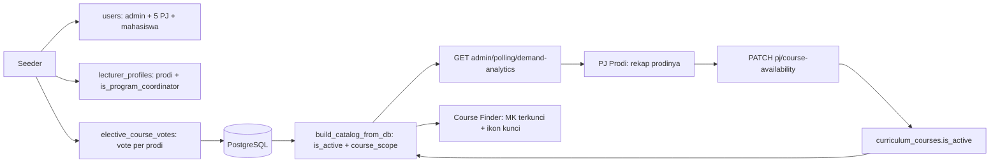

# Low-Level Plan: Rekap Peminatan dan Kontrol Ketersediaan MK per PJ Prodi

**Document ID:** `PLAN-PJ-PRODI-POLLING-20261119`
**Branch:** `docs/pj-prodi-polling-plan` (dilarang `main`)
**Basis commit:** `a1f757a`
**Status:** Disetujui untuk dieksekusi; belum diimplementasikan.

---

## 1. Masalah & Akar

| Gejala terukur | Bukti |
|---|---|
| Dosen bisa melihat rekap voting lintas prodi | `backend/api/polling.py:416` menerima `lecturer`; `:370-372` mempercayai `?study_program=` dari klien; `src/features/dashboard/hooks/useDemandAnalytics.ts:7` memakai default `"all"` |
| Tidak ada data prodi dosen | `users` tidak punya kolom prodi (`database/schema_v2_1_rc1.sql:25-36`); tidak ada tabel `lecturer_profiles`; `/auth/me` mengembalikan `"Teknologi Sains Data"` hardcode (`backend/api/auth.py:198-201`) |
| Rekap TSD tercemar MK lintas prodi | Seeder memberi mahasiswa TSD vote `RKK304` (TRKB) karena mengambil 3 kode pertama dari daftar lintas prodi (`backend/seed.py:669-686`); 45 voter tanpa `StudentProfile` voting bebas ke 8 kode (`:621-668`) |
| `total_students_voted` tidak mengikuti filter prodi | Dihitung sebelum filter di `backend/api/polling.py:303-311` |
| Vote bisa masuk MK wajib / MK prodi lain / prioritas dobel | `submit_vote` hanya mencocokkan id atau kode dari katalog (`backend/api/polling.py:189-198`); constraint unik hanya `(period, user, course)` (`database/schema_v2_1_rc1.sql:2037`) |
| Hapus vote bisa kena periode lama | `remove_vote` memfilter `user_id + course_id` saja (`backend/api/polling.py:269-272`) |
| Fallback TSD menyembunyikan data buruk | `prog_name = "Teknologi Sains Data"` saat lookup katalog gagal (`backend/api/polling.py:341-342`) |
| Course Finder dosen tumpang tindih dengan aplikasi universitas | Nav lecturer hanya Dashboard + Course Finder (`src/app/App.tsx:1618-1622`) |

**Akar:** voting dan rekap tidak punya pemilik prodi di sisi server. Klien menentukan filter, seeder menulis data lintas prodi, dan tidak ada validasi pada saat vote dibuat.

**Koreksi fakta:** delapan kode vote seed (`SIC304`, `SID307`, `RKK304`, `MAS317`, `RKS305`, `TEL302`, `RNT201`, `MNU215`) ternyata ada di `Ekstrak/*.json` dan `database/seed/catalog_canonical.json`. Fallback TSD tidak terpicu oleh kode-kode itu; masalahnya adalah alokasi vote lintas prodi di seeder.

---

## 2. Keputusan Desain

### D1. Satu PJ per prodi, bukan dosen biasa

- Role tetap `lecturer`; PJ adalah `is_program_coordinator = true` di `lecturer_profiles`.
- Lima akun PJ dibuat seeder; akun `dosen.testing@ftmm.unair.ac.id` dihapus dari seeder dan dinonaktifkan pada DB yang sudah terisi.
- Constraint unik parsial `(study_program_id) WHERE is_program_coordinator` menegakkan batas satu PJ per prodi di DB.
- Alasan: dosen biasa tumpang tindih dengan aplikasi universitas; role baru `pj_dosen` akan mengubah CHECK constraint `users.role`, seed, dan seluruh gating role.

### D2. Semua akun dari seeder

- Create-account UI di `AdminAccounts()` dan `POST /api/v1/admin/accounts` dihapus, termasuk `AccountCreateRequest`/`AccountCreateResponse`.
- Manajemen Akun tetap dipakai untuk nonaktifkan, reset password, dan anonimisasi.
- Alasan: admin, PJ, dan mahasiswa demo semuanya deterministik dari seeder; tidak ada jalur pembuatan akun kedua.

### D3. Server yang menentukan scope

- Admin bebas lintas prodi.
- PJ hanya melihat prodinya; permintaan prodi lain menghasilkan 403 `akses_prodi_ditolak`.
- Lecturer tanpa profil atau prodi menghasilkan 403 `prodi_belum_ditetapkan`.
- `faculty_staff` dikeluarkan dari `allowed_roles` dan `ADMIN_ROLES`.
- Endpoint student `/polling/demand-analytics` tetap agregat lintas prodi karena Course Finder memakai `loadDemand("all")` untuk semua role.

### D4. MK dinonaktifkan tetap tampil, tetapi terkunci

- `is_active` MK Pilihan ditulis ke `curriculum_courses.is_active` oleh PJ, bukan ke `courses.is_active` yang bersifat global.
- Katalog tidak lagi menyaring `CurriculumCourse.is_active`; field `is_active` dan `course_scope` diekspos ke `CourseModel`.
- UI menentukan status terkunci dari tiga sumber: `!course.is_active`, paritas MK tidak cocok dengan paritas periode, atau program MK bukan prodi PJ.
- Alasan: PJ perlu melihat rekap MK yang akan dikunci; menyembunyikannya menghilangkan konteks keputusan.

### D5. Validasi vote di server, katalog sebagai sumber kebenaran

- Seeder tidak mengarang kode: MK Pilihan diambil dari `get_all_courses()`, difilter oleh `type` dan `program`.
- `submit_vote` menolak MK bukan Pilihan, MK prodi lain (kecuali scope `fakultas`/`universitas`), MK nonaktif, MK yang paritasnya berbeda dari semester berikutnya mahasiswa, prioritas dobel, dan kuota terlampaui. Voter semester X memilih MK untuk semester X+1.
- `course_id` disimpan sebagai id katalog kanonik; kode tetap di `course_code`.

### D6. Audit memakai jejak yang sudah ada

- `record_admin_action` dipanggil dengan `actor=target=PJ`, `action="course_availability_change"`, `field_name="curriculum_course:<uuid>"`.
- Ponytail: tabel audit PJ khusus hanya ditambahkan jika ada persyaratan audit terpisah.

---

## 3. Skema Data

### Migrasi `backend/migrations/versions/<rev>_add_lecturer_profiles.py`

`down_revision` = head Alembic saat eksekusi. `upgrade()` dan `downgrade()` reversibel; memakai klausa aman.

```sql
CREATE TABLE IF NOT EXISTS lecturer_profiles (
    user_id            uuid PRIMARY KEY REFERENCES users(user_id) ON DELETE RESTRICT,
    study_program_id   uuid NOT NULL REFERENCES study_programs(study_program_id) ON DELETE RESTRICT,
    is_program_coordinator boolean NOT NULL DEFAULT false,
    employee_number    varchar(30),
    created_at         timestamptz NOT NULL DEFAULT now(),
    updated_at         timestamptz NOT NULL DEFAULT now()
);

CREATE UNIQUE INDEX IF NOT EXISTS uq_lecturer_profiles_pj_per_prodi
    ON lecturer_profiles(study_program_id) WHERE is_program_coordinator;
```

`downgrade()`: `DROP INDEX IF EXISTS uq_lecturer_profiles_pj_per_prodi;` lalu `DROP TABLE IF EXISTS lecturer_profiles;`

`database/schema_v2_1_rc1.sql` tidak diubah; itu baseline arsip, bukan otoritas skema baru.

### ORM

- `backend/models.py:52-62` — `User.lecturer_profile` (opsional, `uselist=False`, cascade delete-orphan).
- `backend/models.py:92` — model `LecturerProfile` sebelum `StudentProfile`, dengan relationship ke `User` dan `StudyProgram`.
- `backend/auth.py:157-163` — eager-load `User.lecturer_profile` → `LecturerProfile.study_program` di `get_current_user`.

### Seeder `backend/seed.py`

- `:169-183` — admin tetap dari seeder.
- `:228-245` — lima PJ: `pj.tsd@`, `pj.trkb@`, `pj.rn@`, `pj.ti@`, `pj.te@ftmm.unair.ac.id`; nama `PJ Prodi <KODE>`; password `PjProdi2026!`; `LecturerProfile` dengan `is_program_coordinator=True`; `employee_number` null.
- `:621-646` — 45 voter dibagi 9 per prodi, masing-masing punya `StudentProfile` dan `current_semester` yang sesuai target periode.
- `:637-668` — distribusi vote diturunkan dari `get_all_courses()` yang difilter `type == "Pilihan"` dan `program == prodi voter`. Maksimal 3 vote per voter, prioritas 1/2/3 unik.
- `:669-687` — `mhs_user` (TSD) hanya vote 3 MK Pilihan TSD.
- Sebelum reseed: hapus vote demo lama untuk `student.voter*` dan `mhs_user` pada periode aktif supaya seeder idempoten.

---

## 4. Kontrak REST

Envelope error memakai `backend/api/errors.py`:

```json
{ "error": { "code": "<kode>", "message": "<pesan Indonesia>", "details": [] } }
```

| Method & path | Auth | Request | Sukses | Error |
|---|---|---|---|---|
| `GET /api/v1/admin/polling/demand-analytics?study_program=` | admin bebas; lecturer PJ prodi sendiri | — | 200 `DemandAnalyticsResponse`; `total_students_voted` dihitung dari voter prodi itu | `401 unauthorized`, `403 prodi_belum_ditetapkan`, `403 akses_prodi_ditolak`, `403 forbidden` |
| `GET /api/v1/polling/demand-analytics?study_program=` | student | — | 200 agregat lintas prodi | `401 unauthorized` |
| `GET /api/v1/pj/course-availability?period_id=&semester=` | lecturer + `is_program_coordinator` | — | 200 `{ "data": [{ "curriculum_course_id", "course_id", "course_code", "course_name", "credits", "semester", "type", "course_scope", "is_active", "can_toggle", "lock_reason" }], "meta": { "period_id", "target_semester", "study_program", "total" } }` | `403 not_program_coordinator`, `404 polling_period_not_found` |
| `PATCH /api/v1/pj/course-availability/{curriculum_course_id}` | PJ prodi pemilik MK | `{ "is_active": boolean, "reason"?: string }` | 200 item terbaru | `403 prodi_mismatch`, `404 not_found`, `409 semester_not_eligible`, `422 not_elective`, `422 validation_error` |
| `POST /api/v1/polling/votes` | student | `{ "course_id", "priority": 1..3 }` | 200 `ElectiveVoteResponse` | `400 parity_mismatch`, `403 forbidden`, `409 quota_reached`, `409 course_inactive`, `422 course_not_elective`, `422 course_wrong_program`, `422 duplicate_priority` |
| `DELETE /api/v1/polling/votes/{course_id}` | student | — | 204 | `403 forbidden` |
| `GET /api/v1/courses` | publik | — | 200 + field `is_active`, `course_scope` | — |
| `POST /api/v1/admin/accounts` | — | dihapus | — | 404 |

Alias legacy `/api/*` mengikuti mount yang ada; tidak ada route baru di luar `/api/v1`.

---

## 5. Backend — Per File

**`backend/api/polling.py`**
- `:109-147`, `:149-255`, `:257-277` — tetap student-only. `submit_vote` tambah validasi D5; simpan `course_id` kanonik.
- `:269-272` — `DELETE` tambah filter `polling_period_id` periode aktif.
- `:280-399` — `_fetch_demand_analytics`: hapus fallback TSD; baris dengan MK tak ditemukan dilewati dan `logger.warning`; filter prodi memakai `normalize_prodi()`/`prodi_code()` dari `backend/catalog.py:158-171`; `total_students_voted` dihitung dengan join `User → StudentProfile → StudyProgram` saat filter aktif.
- `:401-422` — endpoint admin memakai aturan D3. Endpoint publik `:401-408` tidak diubah.

**`backend/prodi_access.py`** (baru, sekitar 35 baris)
- `require_pj_scope(current_user, db, requested_prodi)` → mengembalikan `study_program` atau melempar `HTTPException` dengan kode D3. Dipakai `polling.py` dan modul availability.

**`backend/api/pj_courses.py`** (baru) dan `backend/app.py:112`
- `GET /pj/course-availability` — periode aktif atau `period_id`, `target_semester`, `CurriculumCourse` kurikulum otoritatif prodi PJ + scope fakultas/universitas. `can_toggle = type == "Pilihan" AND recommended_semester >= target_semester`; `lock_reason` = `semester_berjalan` | `bukan_pilihan` | `dinonaktifkan`.
- `PATCH /pj/course-availability/{id}` — validasi `can_toggle`, tulis `CurriculumCourse.is_active`, commit, audit D6.
- Daftarkan modul ke loop `mount_resource` di `backend/app.py:112`.

**`backend/api/auth.py`**
- `:175-224` — cabang lecturer `_build_user_response`: ganti hardcode `academic_id`/`unit_name` dengan `employee_number` dan nama prodi; tambah `is_program_coordinator` ke `UserResponse`.
- `:571-606` — hapus `create_account`.

**`backend/schemas.py`**
- `:50-61` — `CourseModel` tambah `is_active`, `course_scope`.
- `:345-355` — hapus `AccountCreateRequest`, `AccountCreateResponse`.
- `:401-460` — skema polling tidak berubah.

**`backend/catalog.py`**
- `:209-221` `_build_course` — teruskan `is_active`, `course_scope`.
- `:224-273` `load_ekstrak` — Ekstrak tidak punya scope; set `course_scope="program_studi"`, `is_active=True`.
- `:478-531` `build_catalog_from_db` — pilih `course_scope` dari row.
- `:605-609` — hapus filter `CurriculumCourse.is_active.is_(True)`; pertahankan filter `Course.is_active.is_(True)`.

**Tes `backend/tests/test_polling.py`** — sepuluh tes regresi: PJ TSD hanya menerima item TSD + MK fakultas; PJ TSD minta TE → 403; lecturer tanpa prodi → 403; `faculty_staff` → 403; denominator mengikuti prodi; vote MK TRKB oleh mahasiswa TSD → 422; vote MK wajib → 422; prioritas dobel → 422; hapus vote tidak menyentuh periode lama; PATCH lintas prodi → 403 dan semester berjalan → 409.

---

## 6. Frontend — Per File

- `src/shared/domain/models.ts:17-38` — `Course` tambah `is_active?`, `course_scope?`.
- `src/shared/domain/course.ts:221-250` — `normalizeCourse` meneruskan keduanya.
- `src/features/catalog/courseData.ts:5-16,30-52` — `ApiCourseItem` dan mapping menerima field baru.
- `src/features/polling/pollingService.ts:53` — `ADMIN_ROLES = ["admin"]`; `:81-91` tidak memilih endpoint dari localStorage; tambah `pjService.getAvailability()` dan `setAvailability()`.
- `src/features/dashboard/hooks/useDemandAnalytics.ts:5-18` — `selectedProdi` PJ diunci ke prodi `AuthUser`; "Semua Prodi FTMM" hanya admin.
- `src/features/dashboard/components/PollingPanel.tsx:180-198` — select prodi disembunyikan untuk PJ; copy "Kaprodi & Dosen" diganti "PJ Prodi & Admin".
- `src/features/course-finder/components/CourseResultsList.tsx:90-192` — `isLocked` dari `!course.is_active`, paritas periode, atau beda prodi; tombol vote `disabled` + `aria-disabled` + `title` alasan; token `text-muted`, `bg-background`, `border-border`; tanpa hex arbitrer.
- `src/features/course-finder/hooks/useCourseFilters.ts:97-149` — filter "Tersedia/Ditutup" memakai `isLocked`, bukan hanya `votes >= minQ`.
- `src/app/App.tsx:77` — `Page` tambah `"pj-courses"`; `:79-83` hapus label `lecturer`; `:1616-1637` nav lecturer = Dashboard + Rekap & Kelola MK; `AdminAccounts()` (~`:92`) hapus form create; halaman baru `src/features/pj/PjCoursesPage.tsx` memakai pola feature-based yang ada.

---

## 7. Diagram



---

## 8. Kriteria Verifikasi

1. `uv run --directory backend alembic upgrade head`, `downgrade -1`, `upgrade head` — bersih dan reversibel.
2. `uv run --directory backend python seed.py` — lima PJ, 45 voter ber-`StudentProfile`, tiap voter maksimal 3 vote dengan prioritas unik, nol vote lintas prodi.
3. `uv run --directory backend python seed_full_catalog.py` lalu `uv run --directory backend python -m pytest tests -q` — hijau termasuk sepuluh tes regresi.
4. `uv run --directory backend python test_api_endpoints.py` — hijau.
5. `pnpm format` lalu `pnpm --silent build -- --logLevel warn` — sukses.
6. Browser `http://localhost:8443`: login `pj.tsd@ftmm.unair.ac.id` → nav Dashboard + Rekap & Kelola MK → rekap hanya MK TSD → MK ganjil dan MK nonaktif tampil abu-abu dengan ikon kunci → toggle 200 → `pj.te@...` ditolak 403 saat mengubah MK TSD → admin tidak melihat form buat akun.
7. Screenshot browser dilampirkan ke kartu Trello terkait.

---

## 9. Dokumentasi & Commit

- `GLOSSARY.md`: PJ Prodi, Rekap Peminatan, MK Terkunci.
- `docs/adr/0002-pj-prodi-sebagai-flag-dan-kunci-di-ui.md`.
- Commit lokal atomik per tahap. Dilarang `git push`.
